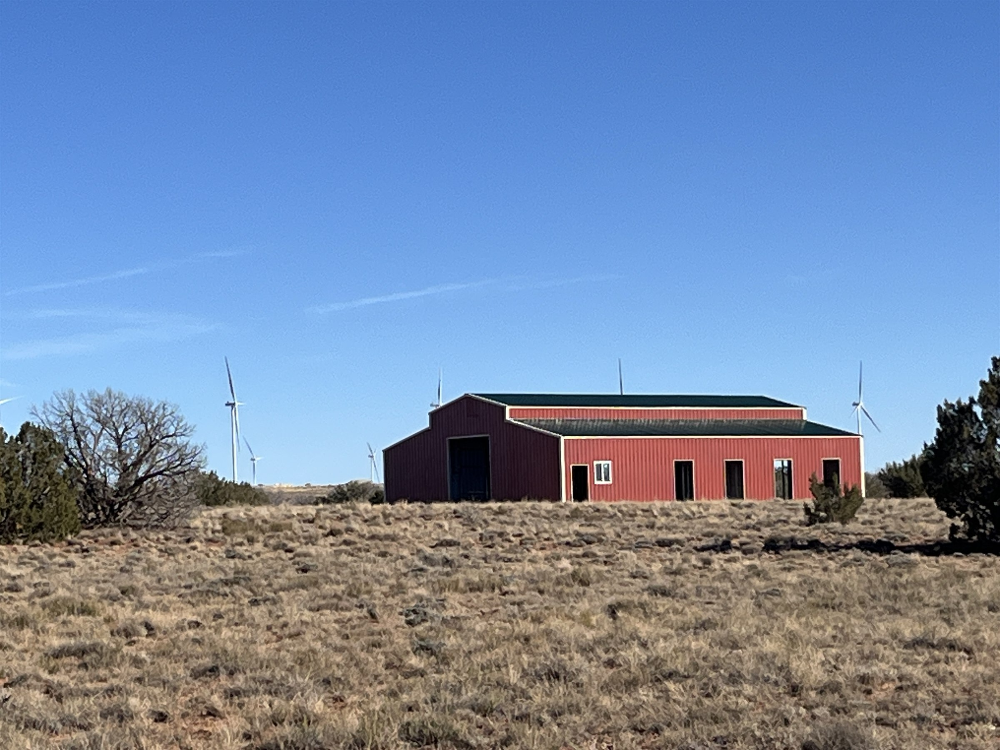

We signed on December 30, 2025. It felt terrific.

The closest comparison is standing at a trailhead early in the morning,
with the whole day ahead and nothing gone wrong yet. Two days later the
calendar turned over, and the first thing in the new year was thirty-seven
acres we were now responsible for.

## What we bought

Thirty-seven acres at about 5,700 feet in northeastern Arizona. A machine
shed. A barn that is still a work in progress. A well and storage tanks.
And wind, a great deal of it, which is where the name comes from.

The previous owners also left a few things behind: a hoop house frame,
abandoned but still standing; a pile of ponderosa and juniper logs they had
cut in a nearby forest; and a corral. The logs already have a job lined up.

## It's a field

Most people would look at this place and see an empty field. It is a field.
The soil is shallow and alkaline, the season is short, and about twelve
inches of rain falls in a year.

But prickly pear and pinyon pine already grow here without anyone's help,
so things do live on this land. They live on its terms, and the plan is to
work the same way.

## What comes next

We're not in a hurry. Most of what we signed for that day is still a plan.
The field is ours to look after now, and the rest is showing up.

Kevin

