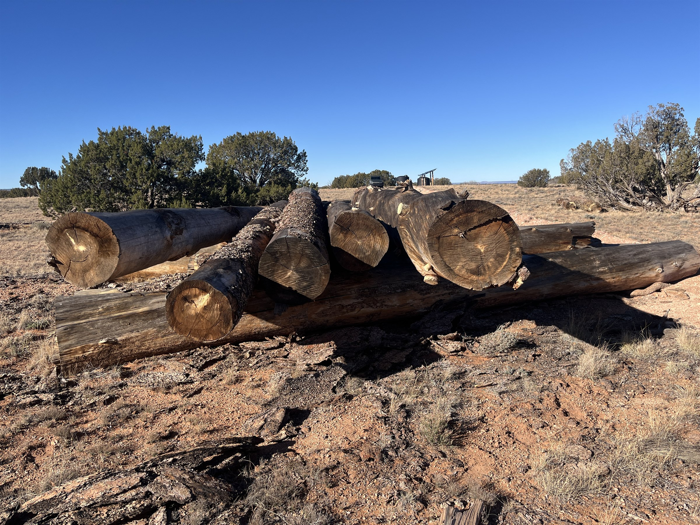

The first hügelkultur mound is taking shape in the zone between the barn
and the machine shed — chosen deliberately, because it's close to the
staged logs, close to water, and sheltered enough to give a first
experiment a fair chance.

*The raw material, staged and waiting. Every log on this pile was cut on the
property.*

## The recipe

The core of the mound is ponderosa pine and juniper cut on the property —
wood the land grew, going back into the land. The logs are soaked
thoroughly before burial (dry wood in a dry climate would pull moisture
*out* of the bed for its first year, which is the opposite of the point),
then capped with native soil.

As the buried wood slowly breaks down, it acts like a sponge: holding
water through dry stretches, feeding the soil above it, and warming the
bed as it decomposes. On ground where bedrock starts inches down and the
native soil holds barely an inch of available water, a mound like this is
less a gardening technique and more a way of manufacturing the soil the
survey says we don't have.

## Why a prototype first

We could have gone straight to building the full orchard-edge system —
mounds paired with contour swales along the planting zone. We didn't,
on purpose.

This first mound is the tuition payment. How fast does the cap settle?
How much water does it really take to charge the core? What does the
first monsoon do to it? Every one of those answers changes how we build
the next ten.

Patience is one of the values on the wall. This is what it looks like
in practice: build one, watch it, *then* build the rest.
