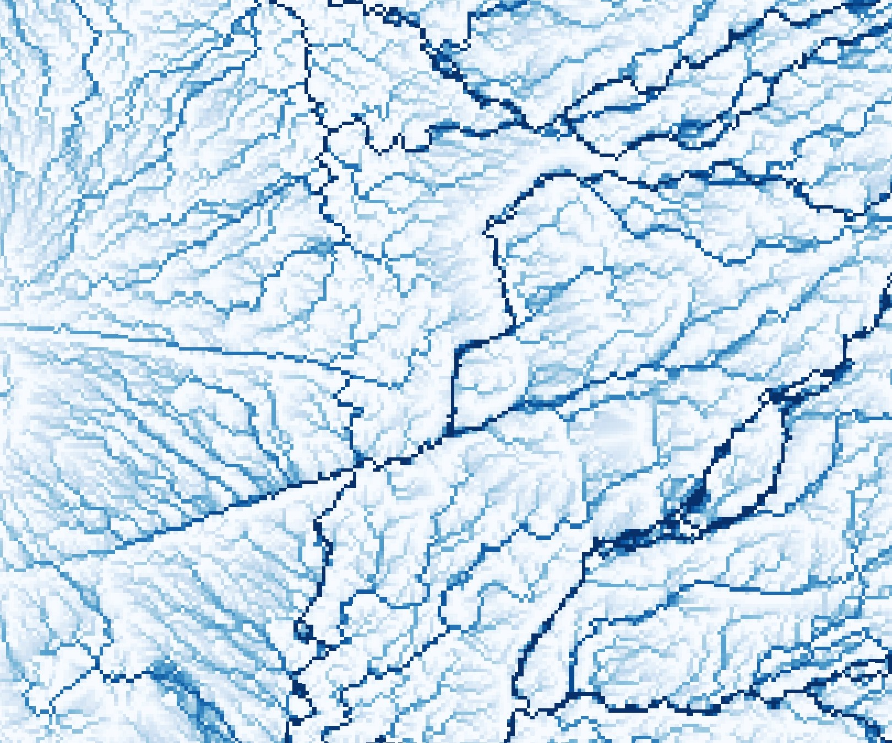
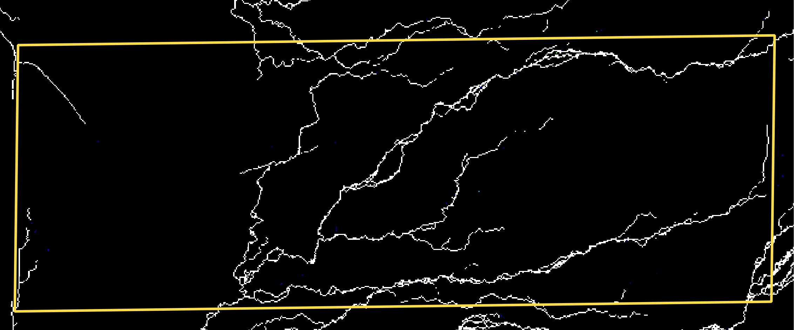
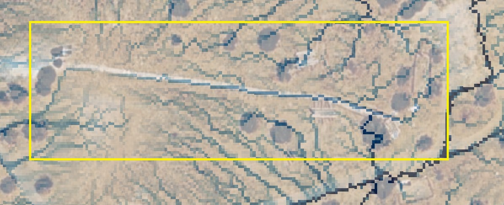
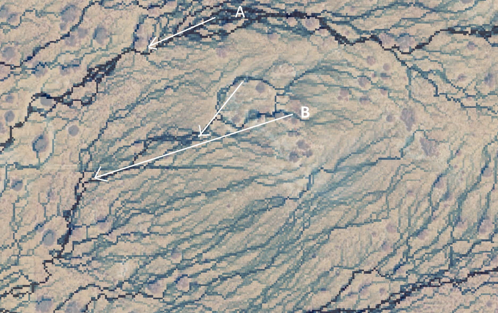
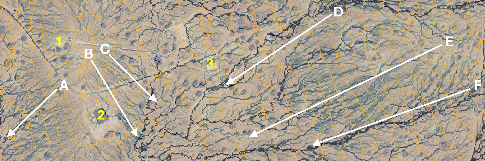

Before planting anything, we wanted to know how water actually moves across
the land. So we built a map of it, using free public data and free software.

*Where runoff collects. Each line is a path water takes downhill, and the
darker the line, the more ground drains into it.*

## Why bother

We get about twelve inches of rain a year, and most of it comes in the
summer monsoon. The soil barely lets water soak in, so a lot of that rain
runs off. Where it runs decides where the swales, the mounds and any pond
should go.

The land falls gently from east to west, about 40 feet across the developed
area, on a grade of 1 to 2 percent.

## How the map was made

1. **Elevation data.** A 1-meter LiDAR elevation model from the USGS 3D
   Elevation Program, flown in the summer of 2023. It's public and free to
   download.
2. **Software.** QGIS, which is also free, with the GRASS `r.watershed`
   tool, after reprojecting the data to UTM Zone 12N.
3. **Flow accumulation.** The tool works out, for every square meter, how
   much upslope ground drains through it. We drew the result on a log scale
   so the drainage network reads like a branching tree.
4. **Contours.** Half-meter contour lines from the same data, laid over
   satellite imagery for reference.

*The same data with everything but the main channels filtered out. The
yellow rectangle is the property.*

## How we checked it

A model is only useful if it matches the ground. Ours had a test built in.
There's an open water-line trench on the property, and it showed up in the
model as a flow line, right where the trench is. That told us the LiDAR data
was accurate enough to trust.

*The check. Inside the yellow box, the straight pale line is the trench,
and the model drew a flow line along it.*

The model also picked out the rocky high ground, the places where channels
meet, and the main drainage paths through the area around the barn, the
wellhead and the machine shed.

*Flow lines splitting around a patch of high ground. The arrows mark flow
directions we were talking through.*

*The working map. 1 is the well site, 2 is the barn and 3 is the machine
shed. The lettered arrows mark the main flows we discussed, and the orange
lines are half-meter contours.*

## What it decides

- **Swales go on contour,** placed to catch spread-out sheet flow before it
  gathers into channels.
- **Hügelkultur mounds go between the channels,** in the zones that catch
  sheet flow. They get built up, because the bedrock is shallow.
- **Any pond sits off-channel,** fed by a diversion. We won't dam the wash.
  An intermittent wash south of the barn carries the concentrated monsoon
  runoff, and flash floods, silt, shallow bedrock and permitting all argue
  against a dam across it.

## What we don't know yet

This is still a model. The real test is watching water move during monsoon
storms and adjusting the earthworks to match. That's on the plan for 2027.

## If you want to try it

The method is repeatable and costs next to nothing. We've since shared the
workflow with a neighbor about 25 miles south. If you've got your own piece
of ground and want the steps, write to
[hello@windrose.farm](mailto:hello@windrose.farm).

Maps made in QGIS. Elevation data from the USGS 3D Elevation Program. Background imagery from Google.

Kevin

