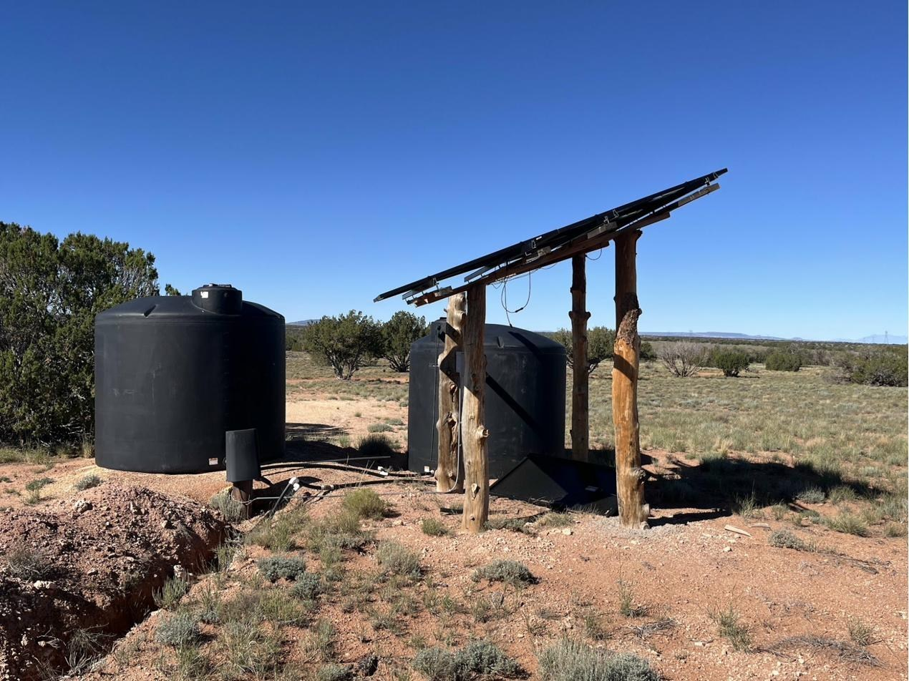
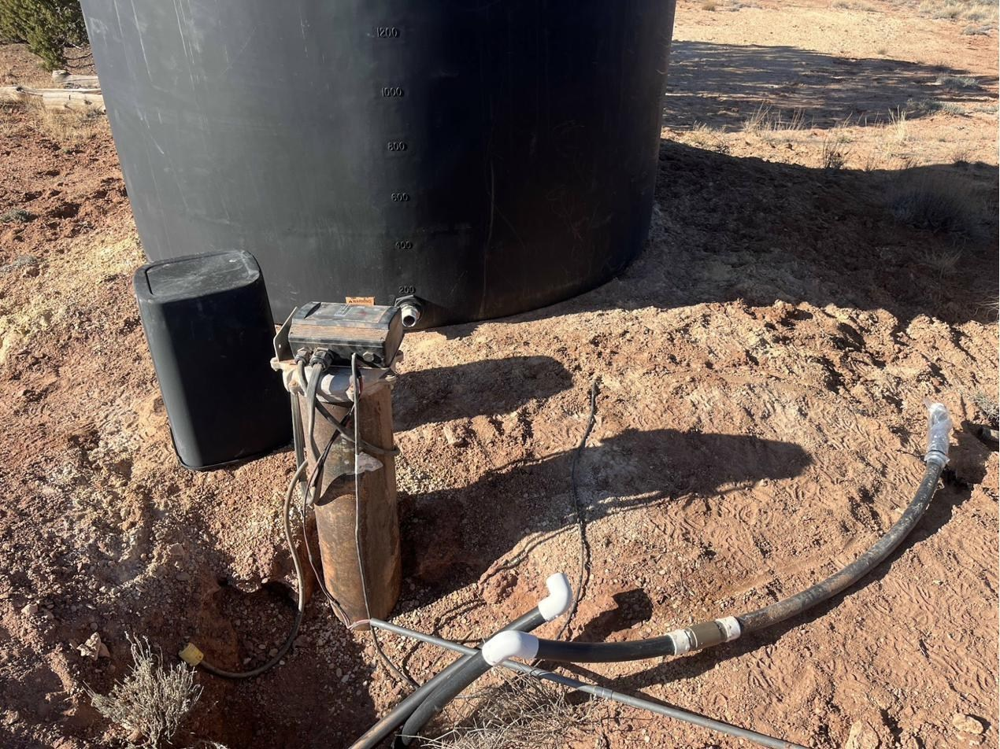
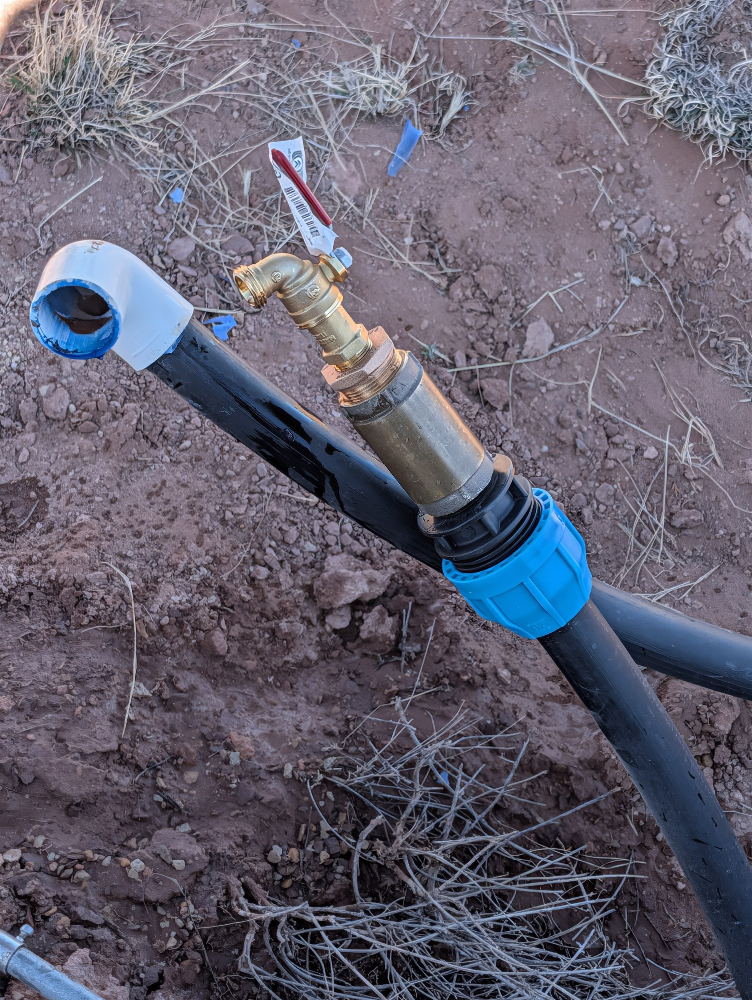
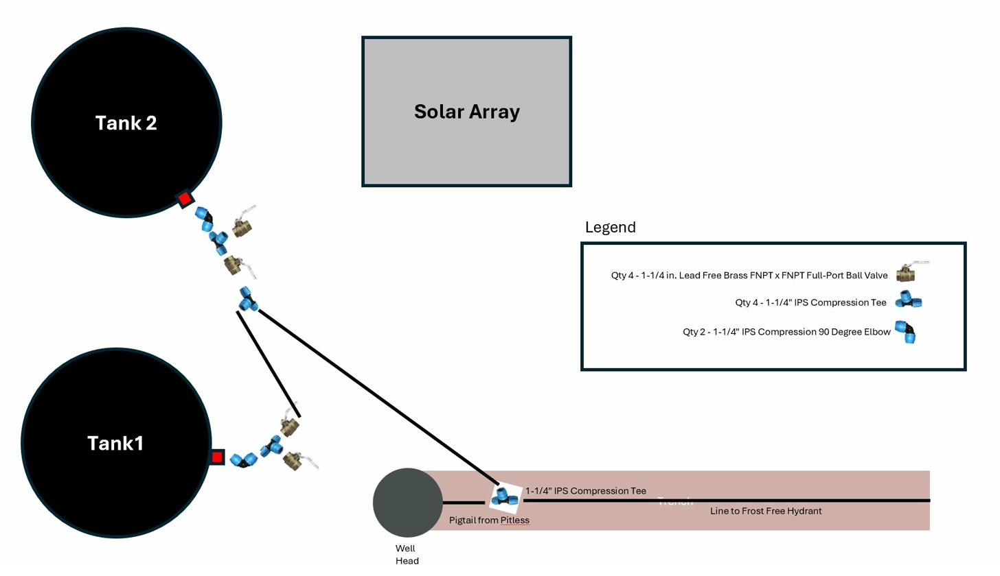
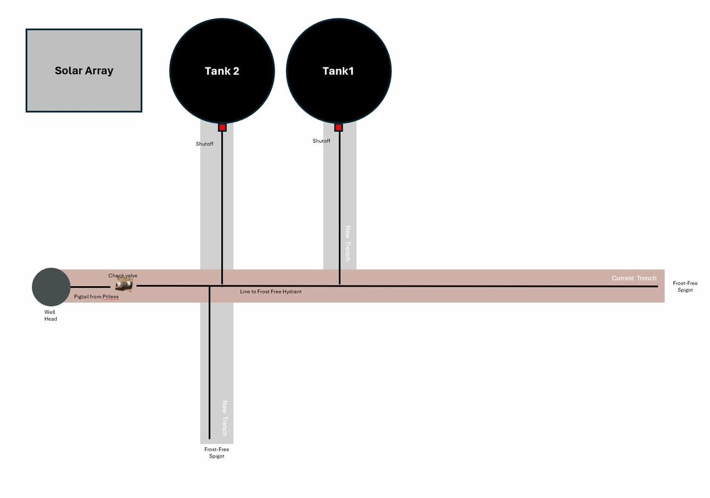

The first rule we set for this place is water before biology. Nothing gets
planted until the water is boringly dependable. It isn't yet, so this is
the first big job.

## What we have

One well, 775 feet deep, giving about 6 gallons a minute. The water is
alkaline. A solar-powered Grundfos submersible pump with a CU200 controller
lifts it into two 2,500-gallon storage tanks.

*The two tanks and the solar array at the well, with the open trench in the
foreground.*

## What we inherited

The previous owners ran the water through HDPE pipe and joined it with PVC
fittings. PVC can't bond to HDPE. The joints failed from freezing and
pressure cycling.

That left open pipes, and rodents got into the tanks through them.

*The wellhead before the rebuild. The white elbows on the black pipe are the
old PVC fittings.*

## The fix

A full rebuild:

1. Replace the PVC joints with HDPE compression fittings, which grip the
   pipe mechanically and don't depend on glue.
2. Bury about 300 feet of 1-1/4 inch HDPE line, 18 to 24 inches down, to
   keep it from freezing.
3. Sanitize the tanks.

We also had a local driller inspect the well, and the water tested clean at
the wellhead. It's also why one of our rules is to rodent-proof everything
we build.

*Old and new side by side, March 2026: a blue compression fitting and brass
ball valve on the well line, next to one of the white PVC elbows it
replaces.*

## The plan changed once we drew it

The first sketch hung valves and tees off each tank. The second lines the
tanks up in a row, gives each its own shutoff, adds a check valve at the
wellhead, and runs lines out to two frost-free spigots.

*The first sketch, with the parts list.*

*The second sketch.*

## The trench

The long trench for the water line was started by the previous owners.
We're finishing it with the Kubota. It's about two feet deep, and we never
hit rock, which is better than the soil map led us to expect.

## Where it stands

Still in progress. This is the job everything else waits on, so it gets
done properly before anything goes in the ground.

*Update, November 2026: still in progress.*

Kevin

