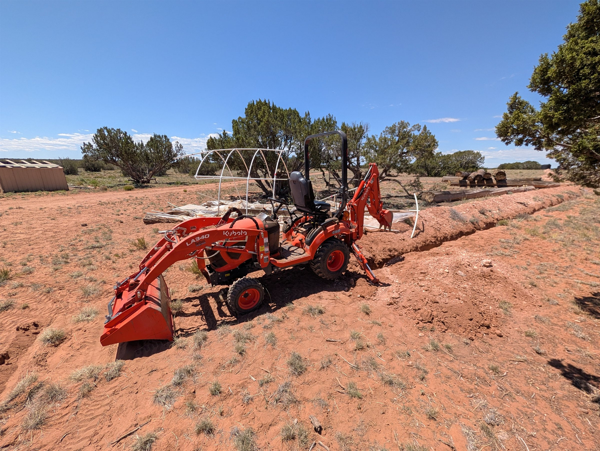

The land here falls gently east to west — about forty feet of drop across
the developed area. When the monsoon rains come, that slope turns twelve
inches of annual precipitation into brief, violent sheets of runoff that
leave the property almost as fast as they arrive.

The swales are our answer: shallow channels cut on contour, staked out
with a level, meant to catch that water mid-flight and hold it long
enough to soak in around the planting zones.

*The Kubota doing the heavy work. Cutting on contour is slow going in ground
this rocky.*

## Designed to be corrected

Here's the part of the plan we're most confident in: we assume we got
some of it wrong.

Contour maps and eyeball surveys only tell you so much. The real test is
a summer storm — watching where water actually goes, where it pools,
where it jumps a swale, where it finds a path nobody predicted. That's
why the roadmap has an entire phase called *observation*: the monsoon
season gets a vote before anything permanent gets planted.

The stakes are in. The first cuts are made. The orchard swale — planned
along the eastern, uphill edge of the old horse exercise area — waits on
what we learn.

## Meanwhile, around the farm

- The first hügelkultur mound continues to settle; we're logging how much
  water the core takes.
- Barn slab and floor infrastructure work continues through the summer.
- Fall soil prep is scoped: elemental sulfur to nudge the alkalinity,
  compost, and mulch — then bare-root orchard stock gets ordered.

Now we watch the sky. For once, procrastination is the assignment.
